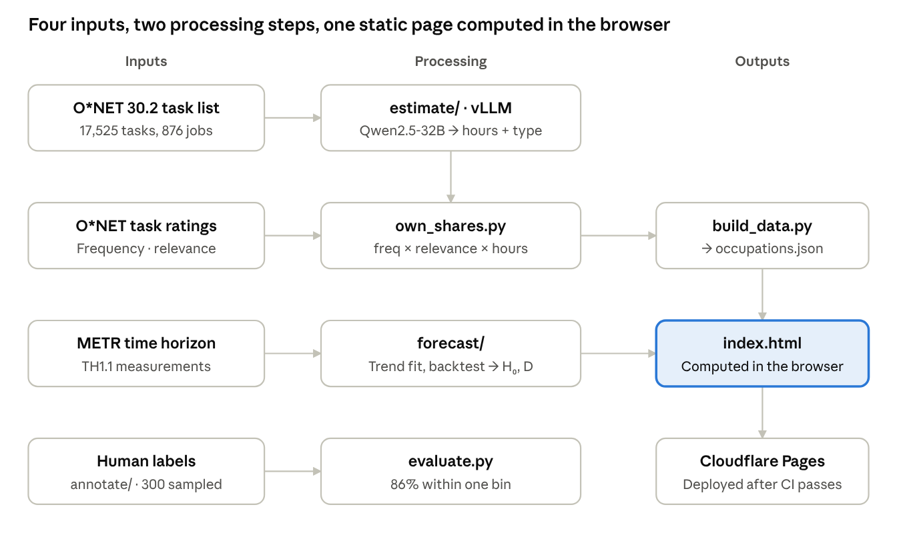

# AI Job Countdown · Design Doc v1

**English** | [中文](DESIGN.zh-CN.md)

Last updated: 2026-11-25 · Spike

## Background and goals

v1 is a static website: type in an occupation and get a countdown to when AI agents could independently handle half of its work time. It covers 876 occupations and 17,517 tasks, in Chinese and English.

**Problem.** Most discussion of whether AI will replace an occupation stops at an "exposure" score, with no time dimension and little visible reasoning. This project breaks each occupation into concrete tasks, uses the growth curve of AI agents' time horizon measured by METR to project when each task falls within AI's range, and publishes every assumption so users can change them.

**Target users.** Job seekers and workers who want to know where their occupation is heading; researchers and journalists who follow AI and the labor market.

**v1 goals**

- Two dates per occupation: "AI capable" and "in practice" (plus adoption lag), and the range across METR's doubling-time fits
- Every assumption adjustable on the page, with the countdown updating live
- Task durations validated by human labels, with the method and limitations shown on the page
- Shareable: a share image, the system share sheet, LinkedIn / X
- A portfolio project as well: vLLM batch inference, prompt iteration and evaluation, tests and CI/CD

**Non-goals (not in v1)**

- Predicting whether an occupation will disappear, or how employment will change
- Adjusting by region (the region selector is shown but does not affect the calculation)
- User accounts or a backend (news is collected on a daily schedule into a static JSON file, so no backend is needed)
- Translating the 17,517 task statements (they stay in O\*NET's original English)

## System overview

All heavy computation happens offline; the website is one static page plus one JSON file.



The GPU is needed only to generate per-instance durations. The countdown itself is computed in the browser, so changing an assumption reruns nothing.

## Data design

The website data depends only on O\*NET and our own estimates; Hatgis-Kessell et al. (2026)'s time shares are used for comparison only and are not part of the website.

| Data | Source | Notes |
| --- | --- | --- |
| Tasks and occupations | O\*NET 30.2 (CC BY 4.0) | 876 occupations, 17,525 tasks; 17,517 after removing 8 "Specialize in…" statements |
| Hours per instance | Our estimates: Qwen2.5-32B-Instruct-AWQ, prompt v3.1 | Skilled worker, end to end, no AI, no waiting time; median of log hours over 5 samples |
| Task type | Same model run, majority of 5 | digital (doable at a computer) / trust (relies on in-person communication) / physical (needs to be on site) |
| Share of work time | Our formula (`web/own_shares.py`) | See the formula below |
| AI time horizon | METR Time Horizon 1.1 | 3.1 hours at 80% reliability, 16 hours at 50% |
| Doubling time | METR TH1.1, fitted by period | 2.9 months since 2024, 4.3 months since 2023 (default), 6.5 months over the full history |
| Chinese occupation names | Hand translated | 116 common occupations with aliases (`build_data.py`); the other 760 in `web/zh_names.tsv` |

**Time-share formula.** O\*NET asks how often workers *perform* a task (for example, daily), not how often they *finish* one. Without a cap, a long task worked on daily would count as hundreds of hours per day, so each occurrence counts at most one workday:

```math
\text{share}(t) = \frac{r_t \cdot f_t \cdot \min(h_t,\, 7)}{\sum_{t' \in o} r_{t'} \cdot f_{t'} \cdot \min(h_{t'},\, 7)}
```

Here r is O\*NET relevance (0–100%), h is hours per instance, and f is occurrences per workday converted from the frequency category, with 250 workdays a year: yearly or less 0.5/year, more than yearly 4/year, more than monthly 2/month, more than weekly 2/week, daily 1, several times daily 3, hourly or more 8.

**Website data: `occupations.json` (about 2 MB)**

```
{"meta": {"source": "...", "n_occ": 876, "n_tasks": 17517},
 "occ": [[onet_code, title_en, title_zh, [aliases], [[task, hours, share_pct, type], ...]], ...]}
```

`share_pct` is a percentage and sums to 100 within each occupation; `type` is 0 digital, 1 trust, 2 physical; tasks are sorted by share, largest first.

## Duration estimation pipeline

The full run of 17,525 tasks took 3.96 hours on one A100 40GB at 1,261 output tokens/s, about $0.45 per 1,000 tasks at $1.99/hour.

**Inference setup (`estimate/estimate.py`)**

- Model: Qwen2.5-32B-Instruct-AWQ, vLLM offline batch inference (`LLM.chat`)
- Prefix caching: every request shares one long system prompt, computed once
- Guided decoding: output constrained by a JSON schema (instance, steps, hours\_low / typical / high, task\_type)
- n = 5 samples per task at temperature 0.7; hours = median of log hours, type = majority vote
- Batches of 512 written to `raw.jsonl`; rerunning the same command skips finished tasks
- Swappable backends: vllm (default), any OpenAI-compatible API, mock (testing without a GPU)
- Environment and model cache live on the Lambda filesystem, so a new instance needs no reinstall

**Prompt iterations**

| Version | What changed | Result |
| --- | --- | --- |
| v2 | Break the task into 2–6 steps with hours each; give a 10% / 90% range | Short tasks inflated: all 13 errors of 2+ bins were overestimates |
| v3 | Allow a single step; count one occurrence of a recurring action; no added prep or paperwork; 4 calibration examples of a few minutes | Short tasks improved, but long tasks were halved too (90th percentile 27 → 10 hours) |
| **v3.1 (used)** | "Don't inflate" applies only to quick routine actions; substantial work is explicitly "don't shorten" | Bias on long tasks back to zero; best exact-match rate and Spearman of the three |

Key call: long tasks drive the countdown, while short tasks are already below AI's current horizon. So some overestimation of short tasks is acceptable, but underestimating long tasks is not; it would move countdowns 4–6 months earlier, overstating the threat from AI.

**Comparison with other models (first 20 labels).** Qwen, Claude and Gemini are within one bin of the human label 90%, 85% and 85% of the time, with no clear gap. The models agree with each other (95–100%) more than any of them agrees with the human. Conclusion: keep Qwen; large models cannot replace human labels.

## Human validation

On 51 human-labeled tasks, v3.1 is within one bin of the human judgment 86% of the time, with quadratic weighted kappa 0.70 and 86% type agreement. These labels were used to tune the prompt, so they are a development set.

**Held-out test set.** Items 54–103 (50 tasks, not used for tuning) were labeled by an AI annotator, Claude Opus 5.5, following `annotate/GUIDELINES.md` without seeing M2's estimates. v3.1 is within one bin of these labels 82% of the time, quadratic weighted kappa 0.67, type agreement 84% (trust has the lowest F1, 0.70), average bias +0.56 bins; 9 of the 10 largest gaps are short tasks estimated too long, the same direction as on the development set. 82% is not higher than M2's 86% against the human, so model-to-model agreement does not appear inflated here, but it is still agreement between models and is not reported as accuracy. A batch version is `annotate/ai_label.py` (any OpenAI-compatible API).

**Sampling.** 300 tasks, stratified across 22 SOC major groups, at most one task per occupation, fixed random seed; the first 20 form the calibration set.

**What is labeled.** Two things per task:

- Duration: 8 bins with edges at 0.25 / 1 / 4 / 8 / 40 / 160 / 500 hours
- Type, decided in order: must be on site → physical; otherwise value comes mainly from in-person communication → trust; everything else → digital

The full rules are in `annotate/GUIDELINES.md`. The labeling tool is a Streamlit app each annotator runs on their own computer; labels are not committed to the repo. The tool never shows the model's answer, and annotators may not ask an AI about specific items.

**Metrics.** Duration: quadratic weighted kappa, share within one bin, Spearman, and bias by bin. Type: accuracy and Cohen's kappa.

**Comparison.** Hatgis-Kessell et al.'s per-instance time *w* is within one bin of the same labels only 51% of the time and 1.45 bins too short on average. For the 214 tasks at their 7-hour cap, our median estimate is 38 hours, and 86% are above 7 hours.

**Still to do**

- A second annotator labels items 1–30 to measure inter-annotator agreement
- ~~Items 51–100 labeled as a held-out test set~~: replaced by an AI annotator on items 54–103, results above
- Type rules have a gap for supervising and evaluating staff; one more convention is needed

## Countdown algorithm

For each task, compute how many months until AI can do it; sort tasks by that wait and add up their work-time shares. The moment the total reaches the threshold is "AI capable". Everything runs in the browser.

```math
m_t = D \cdot \max\left(0,\ \log_2 \frac{h_t \cdot k}{H_0}\right)
```

D is the doubling time in months, h is hours per instance, k is the real-world difficulty factor, and H₀ is the current time horizon.

1. AI capable: use digital and trust tasks only, add shares in order of m, and take the m at which the total reaches the threshold. If coverage never reaches it (too much physical work), show "not covered by the trend".
2. In practice: add the adoption lag to every task and an extra lag to trust tasks, then re-sort and accumulate to the threshold.
3. Range: compute "AI capable" again with D = 2.9 and D = 6.5 months.

| Parameter | Default | Range | Basis |
| --- | --- | --- | --- |
| Reliability (H₀) | 80% (3.1 hours) | 50% (16 hours) / 80% | METR TH1.1 |
| Doubling time D | 4.3 months | 2.5–14 months; presets 2.9 / 4.3 / 6.5 / 12 | METR TH1.1 fits by period |
| Difficulty factor k | ×4 | ×1 to ×32 | Not calibrated; to be estimated from RLI / GDPval |
| Adoption lag | 2 years | 0–5 years | Assumption |
| Extra lag for trust tasks | 3 years | 0–10 years | Assumption |
| Threshold | 50% of work time | 50% / 75% | — |

**Why trust tasks count.** With digital tasks only, customer service reps showed "not covered by the trend", which contradicts what Klarna actually did. AI can technically do trust tasks; the open question is whether people accept AI for them, which a longer adoption lag expresses.

## Website design

Fully static: one `index.html` (about 80 KB, styles and script inline), one `occupations.json` (about 2 MB), one `news.json`, and a QR library `vendor/qrcode.min.js` (qrcode-generator, MIT, about 20 KB). No backend and no build step.

**Look.** A dark "industrial alarm console": a hazard stripe and a scrolling news ticker on top, and a red seven-segment countdown as the main display (years / days / hh:mm:ss.cs). Alert levels: red within 2 years, orange within 5, yellow beyond 5, grey when off the curve.

**Page, top to bottom**

1. Search box, region selector, and 12 shortcut buttons for common occupations
2. Countdown panel: occupation, alert level, seven-segment display, "AI capable" and "in practice" dates, doubling-time range
3. Assumptions panel (six controls) beside field news (hand-picked news for the occupation on top, then news for its field)
4. Task timeline: one row per task on a 0–10 year axis, with the capability point and adoption-lag bar; 12 tasks shown, expandable
5. Sharing: text, share image, LinkedIn, X, system share, copy link
6. Method and "what this number does not tell you"

**Search.** All 876 occupations have Chinese and English names, and 116 common ones have extra aliases ("程序员", "码农"). Chinese input prefers the name that contains the input with the fewest extra characters; English input is scored by word overlap. The occupation lives in the URL hash (`#13-2011.00`), so it can be linked directly.

**Bilingual.** All interface text sits in one `STR` dictionary, and static elements are swapped via `data-i18n` attributes. Language order: the `?lang=` parameter → the last choice (localStorage) → browser language. Switching keeps the current occupation and assumptions. Task statements stay in O\*NET's English.

**Performance and accessibility.** The first load fetches one 2 MB JSON; all computation is client-side. Respects prefers-reduced-motion (no ticker scroll, no centiseconds); no horizontal overflow at 390 px. All output files are written as UTF-8 (fixes a GBK mojibake bug on Windows).

## Field news

v1 news covered only 5 occupations and was hard-coded in `index.html`. It is now collected by **field**: the first two digits of an O\*NET code are the SOC major group (15 computer and math, 23 legal, 29 healthcare practitioners, and so on; 22 in all), and each occupation shows its field's news, so all 876 occupations have an evidence panel.

```
news/fields.json  (names and search terms for 22 fields)
       │
       ▼
news/collect.py ── Google News RSS, one query per field: (AI terms) (field terms…) when:14d
       │            ├─ with NEWS_LLM_API_KEY: an LLM selects strictly, labels "AI progress / reality check", translates to Chinese
       │            └─ without: keyword rules (AI term and field term in the headline, no stock or funding news), English headlines only
       │  + news/curated.json (hand-picked, with occupations and longer summaries, merged as is on every run)
       ▼
web/news.json ── merged with the previous run and deduplicated (a story found in several fields keeps all of them), at most 12 per field, automatic items kept 180 days
       │
       ▼
index.html ── evidence panel: "This occupation" (hand-picked, progress first) + "Field news" (5, expandable); the top ticker shows the latest 24 across the site
```

- **Schedule**: `.github/workflows/news.yml` runs daily at 14:17 UTC and commits `news.json` only when it changed. Commits made with `GITHUB_TOKEN` do not trigger other workflows, so after launch set the variable `NEWS_AUTO_DEPLOY=true` to deploy from the same workflow
- **LLM API**: any OpenAI-compatible API (OpenAI, DeepSeek, Qwen, or our own `vllm serve`), called with the standard library's urllib, no new dependency. The prompt keeps only concrete capability advances or concrete evidence of limits, drops funding, stock and opinion pieces, and forbids adding facts that are not in the headline
- **Headlines and links only**: automatic items store the headline (and translation), source, date and link, not article text
- **Live search per occupation**: a search box at the bottom of the evidence panel, defaulting to "occupation + AI" (the Chinese interface uses the Chinese name and the Chinese Google News edition). Browsers cannot fetch Google News cross-origin, and Google's Custom Search JSON API is closed to new customers, so a Cloudflare Pages Function, `functions/api/search.js`, queries the RSS feed server-side, running two queries, one with impact terms (replace / layoffs / automation) and one with limit terms (errors / rehiring / "won't replace" / shortages), then roughly labeling each headline "AI progress" or "reality check" by keywords and dropping the rest (job ads, courses, explainers). On the page it sits under the hand-picked news for the occupation, marked "automatic search, not verified", and returns headline, source, date and link, cached at the edge for 6 hours. `functions/` must sit at the repo root, where `wrangler pages deploy web` picks it up; test locally with `npx wrangler pages dev web` (under `python -m http.server` the page links to Google News instead)

**`news.json` format**

```
{"updated": "2026-11-25T14:17Z",
 "fields": {"15": {"zh": "计算机与数学", "en": "Computer & math"}, ...},
 "items": [{"id", "k": "signal" | "check", "date", "src", "url", "fields": ["15"],
            "occ": ["Mathematicians"],            // hand-picked items only
            "curated": true,                       // same
            "zh": {"t", "p"}, "en": {"t", "p"}}]}  // automatic items have only t; no zh without an LLM
```

## Sharing

The core of v1 sharing is a saveable share image, because only LinkedIn and X can share straight from a web page; WeChat Moments and Douyin accept only images.

| Platform | Can a web page share directly? | v1 | v2 |
| --- | --- | --- | --- |
| LinkedIn | Yes | share-offsite link + square share image | Per-occupation link preview card |
| X | Yes | intent/tweet link | Same as above |
| WeChat Moments | No (needs a verified official account + an ICP-registered domain) | Portrait share image with QR code; on phones, the system share sheet can send to friends | JS-SDK only if targeting users in mainland China |
| Douyin / Xiaohongshu | No | Portrait share image (image post) | Auto-generated vertical countdown video |

**v1 scope**

Implemented in v1:

- Share image drawn in the browser with canvas, portrait 1080×1350 and square 1080×1080, in the page language; shows the occupation, alert level, a seven-segment countdown (years / days), both dates, the assumptions used, a QR code and a disclaimer. The digits reuse the page's `SEG` polygons; drawing waits for `document.fonts`. QR modules are drawn on whole pixels so they scan reliably
- Preview dialog: the image is an ``, so phones can long-press to save it (the only way inside WeChat's browser); "Save image" downloads a PNG; phones that support `navigator.canShare({files})` get a "Share image" button that sends it straight to the LinkedIn or WeChat app
- System share via `navigator.share` (the phone's share sheet); hidden where unsupported
- LinkedIn: `share-offsite` accepts only a URL, so the button first copies the text to the clipboard and tells the user to paste it; X: `intent/tweet` with text and URL
- Links carry the occupation, language and every non-default assumption: `?lang=en&r=50&d=2.9&k=8&l=1&t=5&p=75#15-1252.00` (r reliability, d doubling time, k difficulty factor, l adoption lag, t extra lag for trust tasks, p threshold), validated and restored on load. Defaults are left out to keep the QR code small
- When previewing locally (localhost, LAN addresses, file://), links and QR codes use `SITE_URL` (`https://ai-job-countdown.pages.dev/`; change it to the real domain at launch)
- Generic link preview: `og.png` (1200×630) plus Open Graph / Twitter Card tags

**v2 scope**

- Link previews: platforms ignore everything after `#` when fetching Open Graph tags, so this needs real paths (`/o/13-2011.00`) and 876 preview images rendered at build time with Playwright
- Douyin short-video template
- Share counts and sources (no personal data)

**Prerequisite.** Sharing is only useful once the site is deployed at a public URL; today's link is private.

## Engineering

Repo `MaaadSpike/ai-job-countdown` (private). Every push runs lint and 19 tests; a daily workflow updates the news; deployment to Cloudflare Pages is manual for now.

| Directory | Contents |
| --- | --- |
| `annotate/` | Streamlit labeling tool, guidelines, agreement metrics |
| `estimate/` | vLLM batch inference, prompt, evaluation against labels |
| `forecast/` | METR trend fitting, walk-forward backtests, countdown algorithm |
| `web/` | Website, `build_data.py`, `own_shares.py`, `zh_names.tsv` |
| `tests/` | pytest |
| `data/`, `runs/` | Third-party data and model outputs; not committed |

**Tests.** Prompt parsing, an end-to-end run with a mock backend (including resume), the countdown algorithm, the time-share formula, and the website data schema (shares sum to 100% per occupation).

**CI/CD.** `ci.yml` runs ruff and pytest on push and pull requests. `deploy.yml` deploys `web/` to Cloudflare Pages with wrangler, using two secrets, `CLOUDFLARE_API_TOKEN` and `CLOUDFLARE_ACCOUNT_ID`; after launch it switches to deploying on every push to main.

**Data and licensing**

- O\*NET: CC BY 4.0, commercial use allowed with attribution
- Hatgis-Kessell et al.: no LICENSE in the repo; used only for academic citation and comparison, not in the website data. The phase-1 task list was exported from their xlsx, but `estimate/check_onet_subset.py` confirms all 17,525 tasks are O\*NET 30.2 rated tasks with identical text, so the list can be rebuilt from O\*NET alone (`prepare_tasks.py --onet-ratings`). O\*NET has 426 more rated tasks (18 occupations) we have not estimated yet. The site carries the O\*NET CC BY 4.0 attribution in its method section
- Labels and model outputs are not committed, so annotators never see each other's or the model's answers

**Compute.** A100 40GB rented on demand from Lambda Cloud ($1.99/hour); the venv and the 19 GB model cache live on the `m2-data` filesystem. Instances must be terminated after a run; one once sat idle for about 15 hours.

## Risks and limitations

The largest uncertainty is the difficulty factor k: each ×4 delays the countdown by two doubling times (about 9 months at the defaults), more than any other error.

| Risk | Impact | Response |
| --- | --- | --- |
| METR tasks are mostly software engineering; other fields need a discount | Countdowns may run early across the board | k is a slider marked "not calibrated"; v2 estimates it from RLI / GDPval |
| Time shares count at most one workday per occurrence | Occupations heavy in long work (software, research) run about 1 year early | Stated in the method; with the alternative time shares, 85% of occupations move less than half a year |
| Short tasks (under an hour) run about 1 bin long | Small: they are already within AI's range | No more prompt tuning, to avoid overfitting |
| Task types misclassified (supervising staff, in-person care) | Occupations such as nurses end up on the curve | Add a labeling rule; show the type so users can see it |
| One human annotator, whose labels were also used for tuning | Accuracy is optimistic | Held-out set of 50 (AI annotator); human spot checks can be added later |
| Users read "AI can do it" as "I will be replaced" | Anxiety or backlash | Show the two dates separately; keep "what this number does not tell you" on the page |
| Automatic news is filtered by headline and may include off-topic or overstated stories | Uneven quality of field news | Strict LLM filter when configured; hand-picked news on top; every item links to the source |

## Roadmap

v1 still needs deployment (a second human annotator is now optional); v2 centers on calibrating the difficulty factor and on link previews.

**v1 launch checklist**

- [x] Durations and types for 17,525 tasks (prompt v3.1)
- [x] 51 human labels and a comparison of three prompt versions
- [x] O\*NET-based time shares; the website no longer depends on Hatgis-Kessell et al.
- [x] Bilingual website and README; Chinese names for all 876 occupations
- [x] pytest + GitHub Actions CI
- [x] Share image (with QR code), system share, LinkedIn / X buttons; links carry the assumptions
- [x] Field news: collected daily for 22 fields, hand-picked items on top
- [ ] (Optional) Second annotator labels items 1–30; compute inter-annotator agreement
- [x] Held-out test set, items 54–103 (AI annotator Claude Opus 5.5); README and method updated
- [ ] Deploy to Cloudflare Pages: set secrets, take `occupations.json` out of `.gitignore`
- [ ] Before making the repo public: no labels and no raw third-party data in it

**v2 plan**

1. Calibrate the difficulty factor k from tasks with real success rates in Remote Labor Index, GDPval and APEX, i.e. how much METR's trend must be discounted for real occupations (also the paper's core question)
2. Link previews: real paths + 876 Open Graph images rendered at build time
3. Translate the 17,517 task statements with vLLM
4. Distillation: train a small model on the current results to split and estimate any occupation a user types, in real time
5. Automatic news pairing (find a "reality check" for each "AI progress" item); regional employment by occupation (StatCan / NOC)
6. Douyin short-video template

## Open questions

- [ ] Is ×4 the right default difficulty factor, or should the default be ×1 with a more prominent "not calibrated" warning?
- [ ] Public domain: `*.pages.dev`, or buy a dedicated domain?
- [x] ~~Licensing of the Hatgis-Kessell et al. task list~~: no longer needed; the list is reproducible from O\*NET alone (checked by `check_onet_subset.py`)
- [ ] If the second annotator never has time, does v1 launch with a single annotator, stated in the method?
- [ ] When does the repo go from private to public: together with the website, or after a paper draft?
