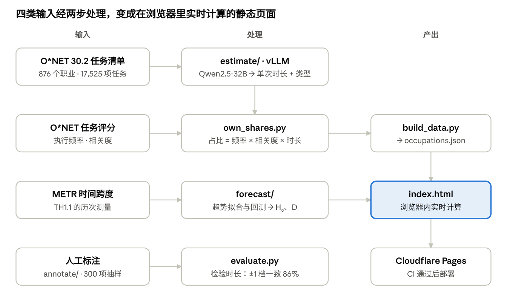

# AI Job Countdown · 设计文档 v1

[English](DESIGN.md) | **中文**

最后更新: 2026-10-19 · Spike

## 背景与目标

v1 是一个静态网站：输入职业，给出「AI agent 能独立完成这个职业一半工作时间」的倒计时，覆盖 876 个职业、17,517 项任务，中英双语。

**要解决的问题。** 关于 AI 会不会取代某个职业，现有讨论大多停留在「暴露度」打分，没有时间维度，也说不清依据。本项目把职业拆成具体任务，用 METR 测得的 AI 时间跨度（time horizon）增长曲线，推算每项任务何时进入 AI 的能力范围，并公开所有假设，让用户自己调。

**目标用户。** 想知道自己职业前景的普通求职者和从业者；关注 AI 与劳动力市场的研究者和媒体。

**v1 目标**

- 每个职业给出两个日期：「能力到位」和「实际落地」（加上落地期），以及在 METR 不同翻倍周期下的区间
- 每个假设都能在页面上调，倒计时实时变化
- 任务时长有人工验证，方法和局限写在页面上
- 可以分享：生成分享图、系统分享、LinkedIn / X
- 同时作为作品集项目：vLLM 批量推理、prompt 迭代与评估、测试和 CI/CD

**非目标（v1 不做）**

- 预测某个职业会不会消失，或者就业人数会怎么变
- 按地区调整（地区选项目前只显示，不参与计算）
- 用户账号、后端服务、实时抓取新闻
- 翻译 17,517 条任务描述（保留 O\*NET 英文原文）

## 系统总览

所有重计算都在离线完成，网站只是一个静态页面加一个 JSON 文件。



GPU 只在生成单次时长时用到；倒计时本身在浏览器里算，所以改假设不需要重跑任何东西。

## 数据设计

网站数据只依赖 O\*NET 和我们自己生成的估计；Hatgis-Kessell et al. (2026) 的时间占比只用于对照，不进入网站。

| 数据 | 来源 | 说明 |
| --- | --- | --- |
| 任务与职业 | O\*NET 30.2（CC BY 4.0） | 876 个职业、17,525 项任务；剔除 8 条「Specialize in…」后剩 17,517 项 |
| 单次时长（小时） | 自己估计：Qwen2.5-32B-Instruct-AWQ，prompt v3.1 | 熟练从业者、端到端、不用 AI、不算等待时间；5 次采样取对数中位数 |
| 任务类型 | 同一次模型运行，5 次多数票 | digital（电脑可完成）/ trust（依赖当面沟通）/ physical（需要现场） |
| 工作时间占比 | 自己的公式（`web/own_shares.py`） | 见下文公式 |
| AI 时间跨度 | METR Time Horizon 1.1 | 80% 可靠度 3.1 小时，50% 可靠度 16 小时 |
| 翻倍周期 | METR TH1.1 分时段拟合 | 2024 年后 2.9 个月、2023 年后 4.3 个月（默认）、全部历史 6.5 个月 |
| 中文职业名 | 手工翻译 | 116 个常见职业带别名（`build_data.py`），其余 760 个在 `web/zh_names.tsv` |

**工作时间占比公式。** O\*NET 问的是从业者多久「做一次」这项工作（比如每天），不是多久「完成一次」。长任务若不设上限，会算出每天几百小时，所以每次最多计一个工作日：

```math
\text{share}(t) = \frac{r_t \cdot f_t \cdot \min(h_t,\, 7)}{\sum_{t' \in o} r_{t'} \cdot f_{t'} \cdot \min(h_{t'},\, 7)}
```

其中 r 是 O\*NET 相关度（0–100%），f 是按频率档换算的每个工作日次数（一年 250 个工作日：一年一次或更少 0.5 次/年，一年多次 4 次/年，一月多次 2 次/月，一周多次 2 次/周，每天 1，每天多次 3，每小时 8），h 是单次时长。

**网站数据 `occupations.json`（约 2 MB）**

```
{"meta": {"source": "...", "n_occ": 876, "n_tasks": 17517},
 "occ": [[onet_code, title_en, title_zh, [aliases], [[task, hours, share_pct, type], ...]], ...]}
```

`share_pct` 是百分数，每个职业合计 100；`type` 为 0 digital、1 trust、2 physical；任务按占比从大到小排序。

## 时长估计流水线

全量 17,525 项任务在一张 A100 40GB 上跑了 3.96 小时，输出 1,261 tokens/s，按 1.99 美元/小时约每 1,000 项 0.45 美元。

**推理配置（`estimate/estimate.py`）**

- 模型：Qwen2.5-32B-Instruct-AWQ，vLLM 离线批量推理（`LLM.chat`）
- prefix caching：所有请求共用一段长 system prompt，只算一次
- guided decoding：按 JSON schema 约束输出（instance、steps、hours\_low / typical / high、task\_type）
- 每条任务采样 n = 5，temperature 0.7；时长取对数中位数，类型取多数票
- 每批 512 条写入 `raw.jsonl`，中断后重跑同一条命令会跳过已完成的任务
- 后端可换：vllm（默认）、openai 兼容接口、mock（无 GPU 测试）
- 环境和模型缓存放在 Lambda 文件系统上，实例关掉后不用重装

**prompt 迭代**

| 版本 | 改了什么 | 结果 |
| --- | --- | --- |
| v2 | 要求拆成 2–6 步、各自估时，给出 10% / 90% 区间 | 短任务被撑大：相差 2 档以上的 13 条全是估长 |
| v3 | 允许只拆 1 步；重复动作只算一次；不加准备和记录时间；增加 4 个几分钟的校准例子 | 短任务改善，但长任务也被砍半（90 分位数 27 → 10 小时） |
| **v3.1（采用）** | 「不要夸大」只适用于例行小动作；实质性工作明确「不要缩短」 | 长任务偏差归零，完全一致率和 Spearman 三版最高 |

关键判断：长任务决定倒计时，短任务本来就低于 AI 当前时间跨度。所以宁可保留短任务偏长，也不接受长任务偏短——后者会让倒计时早 4–6 个月，方向是夸大 AI 的威胁。

**和其他模型的对比（前 20 条标注）。** Qwen、Claude、Gemini 与人工相差 ≤1 档的比例分别是 90%、85%、85%，没有明显差距；模型之间的一致性（95–100%）高于任一模型与人的一致性。结论：继续用 Qwen，大模型不能替代人工标注。

## 人工验证

在 51 条人工标注上，v3.1 有 86% 与人工判断相差不超过一档，二次加权 kappa 0.70，类型一致 86%。这批标注用来调过 prompt，是开发集。

**抽样。** 300 项任务，按 22 个 SOC 大类分层，每个职业至多一项，固定随机种子；前 20 条是试标集。

**标注内容。** 每条标两项：

- 时长：8 档，边界 0.25 / 1 / 4 / 8 / 40 / 160 / 500 小时
- 类型：按顺序判断，必须到现场 → physical；否则价值主要来自当面沟通 → trust；其余 → digital

规则全文在 `annotate/GUIDELINES.md`。标注工具是 Streamlit，每人在自己电脑上跑，结果不提交仓库；标注时不显示模型答案，也不允许问 AI 具体条目。

**指标。** 时长用二次加权 kappa、相差 ≤1 档比例、Spearman、分档偏差；类型用准确率和 Cohen kappa。

**对照。** Hatgis-Kessell et al. 的单次时长 w 与同一批标注相差 ≤1 档只有 51%，平均偏短 1.45 档；他们顶在 7 小时上限的 214 项任务，我们估计的中位数 38 小时，86% 超过 7 小时。

**还没做完**

- 第二位标注者标第 1–30 条，用来报告标注者间一致性
- 标第 51–100 条作为独立测试集，最终准确度以它为准
- 管理、评估下属类任务的类型规则还有空白，需要补一条约定

## 倒计时算法

每项任务算出 AI 能做到它还要等几个月，按等待时间排序累加工作时间占比，到设定比例的那一刻就是「能力到位」。全部在浏览器里计算。

```math
m_t = D \cdot \max\left(0,\ \log_2 \frac{h_t \cdot k}{H_0}\right)
```

D 是翻倍周期（月），h 是单次时长，k 是真实工作难度折扣，H₀ 是当前时间跨度。

1. 能力到位：只用 digital 和 trust 任务，按 m 从小到大累加占比，达到阈值时的 m 即为能力到位时间。覆盖不到阈值（physical 占太多）则显示「趋势线不覆盖」。
2. 实际落地：每项任务加上落地期，trust 任务再加一段额外落地期，重新排序累加到阈值。
3. 区间：用 D = 2.9 和 6.5 个月各算一次能力到位时间。

| 参数 | 默认 | 可调范围 | 依据 |
| --- | --- | --- | --- |
| 可靠度（H₀） | 80%（3.1 小时） | 50%（16 小时）/ 80% | METR TH1.1 |
| 翻倍周期 D | 4.3 个月 | 2.5–14 个月，预设 2.9 / 4.3 / 6.5 / 12 | METR TH1.1 分时段拟合 |
| 难度折扣 k | ×4 | ×1 到 ×32 | 未校准，待 RLI / GDPval 估计 |
| 落地期 | 2 年 | 0–5 年 | 经验假设 |
| trust 额外落地期 | 3 年 | 0–10 年 | 经验假设 |
| 阈值 | 50% 工作时间 | 50% / 75% | — |

**为什么 trust 任务也计入。** 只算 digital 时，客服会显示「趋势线不覆盖」，和 Klarna 的实际情况矛盾。trust 任务技术上可以做，差别在于人们愿不愿意交给 AI，所以用更长的落地期表达。

## 网站设计

纯静态：一个 `index.html`（约 60 KB，样式和脚本内联）加一个 `occupations.json`（约 2 MB），没有后端，没有构建步骤。

**视觉。** 深色「工业警报控制台」风格：顶部警示条和滚动新闻栏，主视觉是红色七段数码管倒计时（年 / 天 / 时:分:秒.百分秒）。警报等级：2 年内红色、5 年内橙色、5 年以上黄色、曲线外灰色。

**页面从上到下**

1. 搜索框 + 地区选择 + 12 个常见职业快捷按钮
2. 倒计时主屏：职业名、警报等级、数码管、「能力到位」和「实际落地」日期、翻倍周期区间
3. 假设面板（六个控件）与新闻证据（每条「AI 进展」配一条「现实检验」）并排
4. 任务时间线：每项任务一行，0–10 年轴上标出能力到位点和落地期条，默认显示 12 项可展开
5. 分享文案与复制按钮
6. 方法说明与「这个数字不能说明什么」

**搜索。** 876 个职业都有中英文名，116 个常见职业另有别名（「程序员」「码农」）。中文输入优先匹配「包含输入且多出字数最少」的名字，英文按词重合打分。职业写在 URL hash 里（`#13-2011.00`），可以直接链接。

**中英双语。** 所有界面文字在一个 `STR` 字典里，静态元素用 `data-i18n` 属性替换。语言优先级：`?lang=` 参数 → 上次选择（localStorage）→ 浏览器语言。切换时保留当前职业和假设。任务描述保留 O\*NET 英文。

**性能与可访问性。** 首屏只拉一个 2 MB JSON；所有计算在客户端。支持 prefers-reduced-motion（关闭滚动和百分秒）；手机 390 px 宽无横向溢出。所有输出文件强制 UTF-8（修过 Windows 下 GBK 乱码的 bug）。

## 分享功能

v1 的核心是一张可保存的分享图，因为只有 LinkedIn 和 X 能从网页直接分享，微信朋友圈和抖音都只能发图片。

| 平台 | 网页能否直接分享 | v1 方式 | v2 方式 |
| --- | --- | --- | --- |
| LinkedIn | 能 | share-offsite 链接 + 方版分享图 | 每个职业独立的链接预览卡片 |
| X | 能 | intent/tweet 链接 | 同上 |
| 微信朋友圈 | 不能（需认证公众号 + 备案域名） | 竖版分享图 + 二维码；手机上的系统分享可发给好友 | 仅在面向国内用户时考虑 JS-SDK |
| 抖音 / 小红书 | 不能 | 竖版分享图（图文） | 自动生成竖屏倒计时短视频 |

**v1 范围**

- 分享图：浏览器内用 canvas 绘制，竖版 1080×1350 和方版 1080×1080，中英文；内容为职业名、倒计时、能力到位日期、所用假设、网址二维码
- 系统分享：`navigator.share`（手机上弹出系统菜单，含微信、WhatsApp），桌面端退回复制链接
- LinkedIn / X 按钮和复制链接
- 分享的链接带上职业和语言（已支持 `?lang=en#13-2011.00`）

**v2 范围**

- 链接预览：平台抓取 Open Graph 时忽略 `#` 后的内容，需要改成独立路径（`/o/13-2011.00`），并在构建时用 Playwright 为 876 个职业各生成一张预览图
- 抖音短视频模板
- 分享次数和来源的统计（不含个人信息）

**前提。** 分享只有在网站部署到公开网址后才有用；目前的链接是私有的。

## 工程

仓库 `MaaadSpike/ai-job-countdown`（private），每次 push 跑 lint 和 11 个测试，部署到 Cloudflare Pages 目前手动触发。

| 目录 | 内容 |
| --- | --- |
| `annotate/` | Streamlit 标注工具、标注规则、一致性计算 |
| `estimate/` | vLLM 批量推理、prompt、与标注的对比评估 |
| `forecast/` | METR 趋势拟合、walk-forward 回测、倒计时算法 |
| `web/` | 网站、`build_data.py`、`own_shares.py`、`zh_names.tsv` |
| `tests/` | pytest |
| `data/`、`runs/` | 第三方数据和模型输出，不提交 |

**测试。** prompt 解析、用 mock 后端端到端跑通估计流程（含断点续跑）、倒计时算法、时间占比公式、网站数据格式（每个职业占比合计 100%）。

**CI/CD。** `ci.yml`：push 和 PR 时跑 ruff 和 pytest。`deploy.yml`：用 wrangler 把 `web/` 部署到 Cloudflare Pages，需要 `CLOUDFLARE_API_TOKEN` 和 `CLOUDFLARE_ACCOUNT_ID` 两个 secret；公开后改为 push 到 main 自动部署。

**数据与授权**

- O\*NET：CC BY 4.0，允许商业使用，需注明出处
- Hatgis-Kessell et al.：仓库没有 LICENSE，只作学术引用和对照，不进入网站数据；但第一期的任务清单是从他们的 xlsx 导出的（任务文字本身来自 O\*NET）
- 标注结果和模型输出不提交，避免标注者看到彼此或模型的答案

**算力。** Lambda Cloud 按需租 A100 40GB（1.99 美元/小时），venv 和 19 GB 模型缓存放在 `m2-data` 文件系统上。跑完必须 Terminate，曾经空转约 15 小时。

## 风险与局限

最大的不确定性是难度折扣 k：k 每乘以 4，倒计时就延后约两次翻倍周期（默认参数下约 9 个月），比其他所有误差都大。

| 风险 | 影响 | 应对 |
| --- | --- | --- |
| METR 题目以软件工程为主，推到其他行业要打折 | 倒计时可能整体偏早 | k 做成滑块并标「未校准」；v2 用 RLI / GDPval 估计 |
| 时间占比每次最多计一个工作日 | 长任务多的职业（软件、研究）约早 1 年 | 方法说明里写明；换用另一种占比时 85% 职业变化不到半年 |
| 1 小时以内的短任务偏长约 1 档 | 影响很小，它们本来在 AI 能力范围内 | 不再调 prompt，避免过拟合 |
| 任务类型分错（管理下属、当面护理） | 护士等职业被算进曲线 | 补标注规则；展示类型让用户看得见 |
| 只有一位标注者，且用于调参 | 准确度偏乐观 | 第二位标注者 30 条 + 独立测试集 50 条 |
| 用户把「能做到」理解成「会被取代」 | 引发焦虑或质疑 | 两个日期分开显示；「这个数字不能说明什么」放在页面上 |
| 新闻是手动收录的 5 个职业 | 其他职业没有证据栏 | v2 自动抓取并配对 |

## 路线图

v1 剩下分享功能、第二位标注者和部署三件事；v2 的重心是校准难度折扣和链接预览。

**v1 发布清单**

- [x] 17,525 项任务的时长与类型（prompt v3.1）
- [x] 51 条人工标注与三版 prompt 对比
- [x] O\*NET 时间占比，网站不再依赖 Hatgis-Kessell et al.
- [x] 中英双语网站和 README，876 个职业都有中文名
- [x] pytest + GitHub Actions CI
- [ ] 分享图、系统分享、LinkedIn / X 按钮
- [ ] 第二位标注者完成第 1–30 条，算标注者间一致性
- [ ] 标第 51–100 条作为独立测试集，更新 README 和方法说明中的准确度
- [ ] 在 Cloudflare Pages 部署，配置 secret，把 `occupations.json` 移出 `.gitignore`
- [ ] 公开仓库前检查：没有标注结果、没有第三方原始数据

**v2 计划**

1. 校准难度折扣 k：用 Remote Labor Index、GDPval、APEX 中有真实成功率的任务，估计 METR 趋势迁移到真实职业时要打多少折（也是论文的核心问题）
2. 链接预览：独立路径 + 876 张构建时生成的 Open Graph 图
3. 用 vLLM 翻译 17,517 条任务描述
4. 蒸馏：用当前结果训练小模型，支持用户输入任意职业时实时拆分和估计
5. 新闻自动抓取与配对；地区接入当地按职业的就业人数（StatCan / NOC）
6. 抖音短视频模板

## 待决问题

- [ ] 难度折扣默认 ×4 是否合适，还是默认 ×1 并更显眼地提示「未校准」？
- [ ] 公开的域名：用 `*.pages.dev`，还是买一个独立域名？
- [ ] 以后可能商业化的话，是否仍要发 GitHub issue 向 Hatgis-Kessell et al. 询问授权（任务清单目前从他们的 xlsx 导出）？
- [ ] 第二位标注者如果一直没空，v1 是否以单人标注上线，并在方法说明里写明？
- [ ] 仓库何时从 private 改为 public：和网站同时，还是等论文初稿之后？
